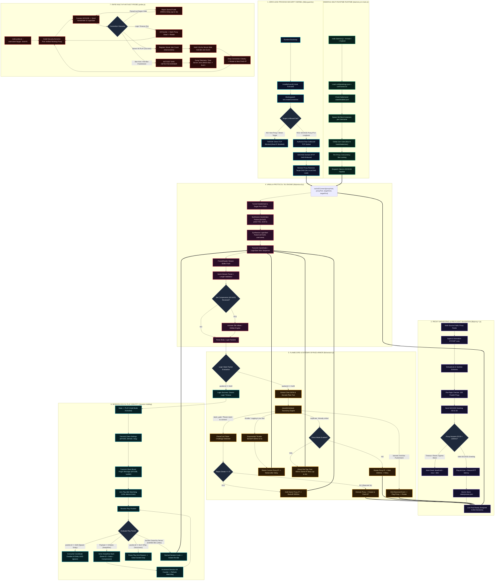

# BlinkMC Complete Technical Architecture & Bypass Engine

A structural blueprint of the BlinkMC Minecraft bot fleet engine, detailing its zero-leak network firewall, proxy verification pipeline, custom protocol framing, gateway bypass armor, and anti-bot probe subsystem.

