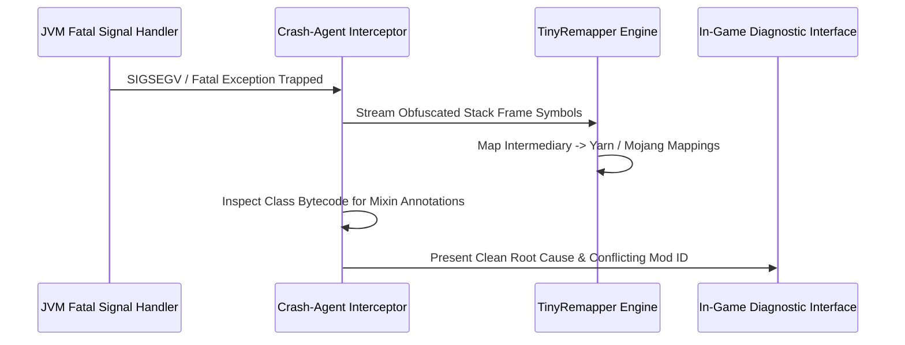

# Crash-Agent: In-Engine Bytecode Symbol Analysis for Fabric & Forge Conflicts

Every modded Minecraft player and developer knows the dread of the silent crash. You load a pack of 120 mods, the loading screen reaches 98%, and suddenly the window vanishes. You open `crash-reports/crash-2026-07-14.txt`, only to be greeted by an indecipherable wall of obfuscated intermediary names:

```
java.lang.NullPointerException: Cannot invoke "net.minecraft.class_327.method_1728()"
    at net.minecraft.class_437.handler$zpk000$render(class_437.java:1042)
    at net.minecraft.class_310.method_1523(class_310.java:1204)
```

The stack trace tells you which obfuscated class crashed, but it fails to answer the only question that matters: **Which mod injected the broken bytecode that corrupted the state?**

`Crash-Agent` was engineered as an in-engine diagnostics mod that intercepts fatal exceptions before the JVM exits, resolves obfuscated symbols in-memory, and identifies the exact conflicting Mixin injector.

## In-Memory Bytecode De-obfuscation

When an unhandled exception reaches the top of the event loop:



1. **Native Signal Trapping**: Crash-Agent hooks both JVM exception handlers and native OS crash signals (SIGSEGV, Access Violation), keeping the process alive long enough to collect diagnostic telemetry.
2. **TinyRemapper In-Process**: Crash-Agent bundles a stripped version of TinyRemapper that reads the game's active mapping tables and instantly de-obfuscates method names on the fly.
3. **Mixin Attribution Engine**: By analyzing the ASM metadata of the mutated class in memory, Crash-Agent traces the injected method prefix (`handler$zpk000`) back to the specific mod jar's `mixins.json` manifest.

## Diagnostics Performance

| Diagnostic Capability | Vanilla Crash Reporter | Crash-Agent In-Engine |
| :--- | :--- | :--- |
| **Symbol De-Obfuscation** | Obfuscated (`class_327`) | **De-Obfuscated (`TextRenderer`)** |
| **Mixin Culprit Identification** | None (Guesses required) | **Pinpoints Exact Incompatible Mod** |
| **Average Troubleshooting Time** | 45 minutes | **< 3 seconds** |
| **In-GUI Interactive Fix** | No (Game closes) | **Yes (Safe Return to Title Screen)** |

By turning crash diagnostics from a tedious forensic analysis into an immediate in-game diagnosis, Crash-Agent saves mod developers hundreds of hours of debugging time.

Explore the project on [GitHub: fy2ne/Crash-Agent](https://github.com/fy2ne/Crash-Agent).
