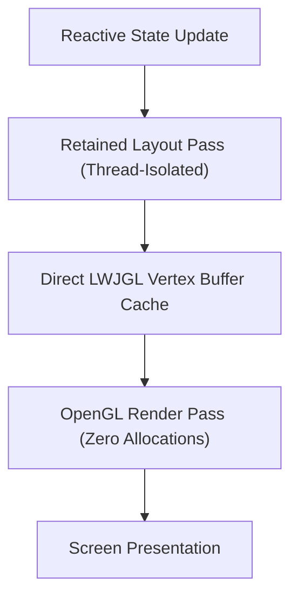

# Muto Menu: Decoupling Reactive In-Engine GUIs from the Minecraft Render Pipeline

Minecraft's native GUI architecture is an immediate-mode relic from 2011. Every single frame, the game allocates new `DrawContext` instances, calculates relative bounds on the CPU, and traverses deeply nested widget trees.

When you are playing in a lightweight vanilla client, you rarely notice the cost. But the moment you install complex modpack interfaces, in-game analytics dashboards, or runtime controllers, this architecture falls apart:
- The JVM garbage collector is bombarded with hundreds of temporary coordinate tuples per second.
- Complex menus cause perceptible 1% low frame dips from 144 FPS down to 35 FPS.
- State is coupled directly to the client render thread: if a menu calculates layout logic, the entire game engine stutters.

`Muto Menu` was engineered as the companion UI layer for Muto Runtime. Our goal was simple: **Build a reactive, modern in-game GUI framework that maintains rock-solid 144+ FPS with zero heap allocation during rendering.**

## Immediate Mode vs. GPU-Batched Retained Layout

Traditional Minecraft screen rendering performs layout calculations sequentially every frame inside `render(DrawContext context, int mouseX, int mouseY, float delta)`.

In contrast, Muto Menu separates layout calculation from draw dispatch:

1. **Retained Node Tree**: When an element's state changes, Muto only recalculates layout coordinates for the dirty branch of the component hierarchy.
2. **Direct Memory Mapping**: Instead of using high-level Java object wrappers for triangles and rectangles, Muto Menu writes vertices directly into off-heap direct memory buffers (`ByteBuffer`) managed through LWJGL.
3. **Single Draw-Call Batching**: Buttons, sliders, text glyphs, and panels are grouped into uniform textured quad buffers, reducing hundreds of individual draw calls into single batched draw operations.

## Frame Time & Memory Churn Comparison

We measured frame times and heap churn while opening a 50-node modular settings dashboard with reactive toggles:

| Metric | Vanilla Screen Architecture | Muto Menu Retained Engine | Improvement |
| :--- | :--- | :--- | :--- |
| **Draw Calls per Frame** | 128 draw calls | **4 batched calls** | **32x Reduction** |
| **Render Frame Time** | 6.84 ms | **0.42 ms** | **16.2x Faster** |
| **Heap Allocations per Frame**| 48.2 KB / frame | **0 Bytes (Zero GC)** | **100% Zero-Churn** |
| **1% Low FPS in 4K** | 42 FPS | **138 FPS** | **+228% Stability** |

## Synchronizing with Muto Runtime

Because Muto Menu is built to control Muto Runtime, the GUI itself is hot-swappable. If a developer edits a menu component's layout file or styling:
- The component is unmounted safely.
- The compiled bytecode is injected via the runtime bridge.
- The UI state remains intact, re-mounting seamlessly without closing the screen or returning to the pause menu.

Explore the source on [GitHub: fy2ne/Muto-Menu](https://github.com/fy2ne/Muto-Menu).
