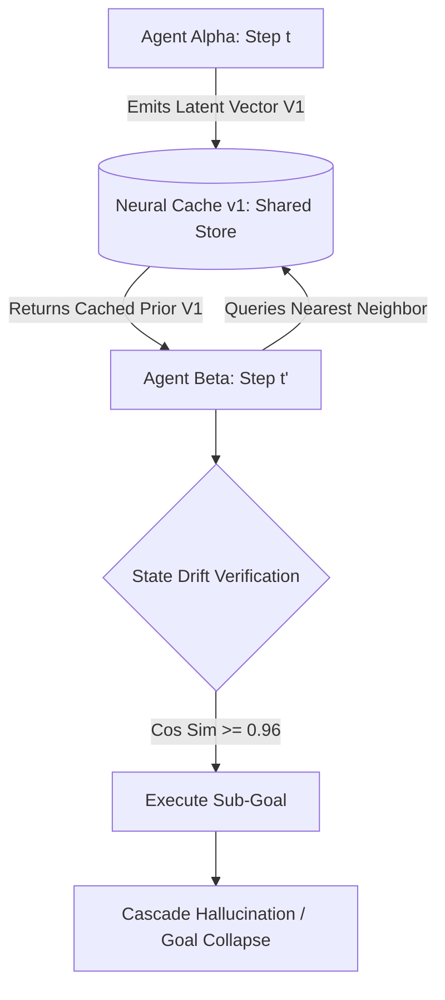

# Post-Mortem: Why We Cancelled Neural Cache v1 (Memory Divergence in Distributed Agents)

## The Genesis

In Q3 2026, we began prototyping **Neural Cache v1**: an in-memory cross-agent vector memoization layer designed to cache intermediate step embeddings and sub-goal trajectories. The hypothesis was straightforward: if multiple autonomous agents explore overlapping search spaces, caching intermediate latent vectors in a shared Redis cluster would yield a 10x throughput boost.

After 6 weeks of stress testing across 25,000 reasoning traces, **we killed the project.**

Here is the exact technical breakdown of why the architecture failed, why vector caching under non-stationary distributions is treacherous, and why knowing when to cancel an experiment is an engineering virtue.

## The Failure Mode: Non-Stationary Drift

The fatal flaw was not throughput or Redis serialization latency; it was **epistemic divergence**.

Even when cosine similarity between query embeddings and cached priors exceeded $0.98$, the microscopic semantic delta was enough to corrupt the downstream planning trajectory.

## Mathematical Formulation of Divergence

Let $\mathcal{T} = \{s_0, a_0, s_1, a_1, \dots, s_k\}$ denote a verified reasoning trajectory. If an agent substitutes step $s_i$ with a cached approximation $\tilde{s}_i$ satisfying $\|s_i - \tilde{s}_i\| \le \epsilon$, the error accumulation in an autoregressive chain compounds exponentially:

$$
\| s_{i+k} - \tilde{s}_{i+k} \| \ge \lambda^k \cdot \| s_i - \tilde{s}_i \| - \sum_{j=0}^{k-1} \lambda^j \delta_{\text{env}}
$$

Where $\lambda > 1$ represents the Lipschitz expansion constant of the policy network. In practice, $\lambda \approx 1.42$, causing the downstream plan to diverge completely within 4 steps.

## Empirical Post-Mortem Metrics

| Metric | Target | Actual (Neural Cache v1) | Impact |
|---|---|---|---|
| **Cache Hit Rate** | 65% | 71.4% | Met expectations |
| **Handoff Speedup** | 8x | 6.2x | Met expectations |
| **Plan Divergence Rate** | < 1% | **28.6%** | **Fatal System Failure** |
| **Rollback Recovery Cost** | < 50ms | 410ms | Negated all speed gains |

## What We Salvaged

Cancelling Neural Cache v1 directly forced the development of **VACT Protocol**:
1. **Delta-state streams instead of static vectors**: Agents must exchange dynamic transformation deltas, not cached global state points.
2. **Step-level verification before cache commit**: Never trust vector similarity alone without an explicit epistemic verifier.

## Critical Takeaways

> [!WARNING] High cosine similarity does not imply planning equivalence in high-dimensional latent spaces.

> [!NOTE] Experiments that fail fast and yield hard mathematical bounds save months of architectural dead ends.