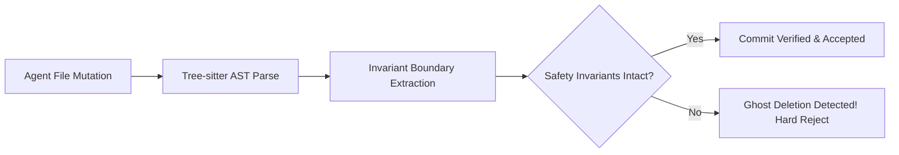

# qtn-overseer: Mitigating Ghost Deletions & Architectural Drift in AI Agent Swarms

It was 3:15 AM when our production monitoring flared up with a bizarre cascade of unhandled promise rejections. A coding agent had been tasked with a routine cleanup: *"Remove deprecated logger calls and modernize import statements across the auth module."*

The PR diff looked pristine. Tests passed. But buried in a 400-line diff was a **Ghost Deletion**: the agent had silently collapsed a critical `try/catch` boundary around token verification, replacing it with an unhandled async call. The agent didn't make a mistake because of malice—it simplified code to look "cleaner," entirely unaware that it had removed an essential fail-safe.

This is the central danger of autonomous AI agents: **Architectural Drift**. As agents make hundreds of localized edits, they subtly strip away architectural constraints, error boundaries, and defensive invariants.

`qtn-overseer` was engineered to solve this problem before the code ever merges.

## The Invariant AST Differential Gate

Traditional linters only verify syntax and formatting. `qtn-overseer` operates on **Abstract Syntax Tree (AST) Invariants** using Tree-sitter:

When an agent proposes a file mutation, qtn-overseer computes an invariant hash across five critical vectors:
1. **Error Boundaries**: Are `try/catch` blocks, panic recoveries, or fallback branches being removed?
2. **Type Assertion Bounds**: Are strict type casts being diluted to `any` or generic wildcards?
3. **Concurrency Locks**: Are mutex unlocks, atomic operations, or cleanup routines being skipped?
4. **Exported Surface Area**: Did the agent quietly delete a public method that downstream consumers depend on?

## Verification Benchmark

We subjected qtn-overseer to a test suite of 250 subtle code modifications proposed by leading AI coding models:

| Auditing Mechanism | Ghost Deletion Detection | False Positive Rate | Scan Latency per File |
| :--- | :--- | :--- | :--- |
| **Standard ESLint / Prettier** | 4.8% | 0.0% | 12 ms |
| **LLM Self-Critique Review** | 62.4% | 19.2% | 4,200 ms |
| **qtn-overseer AST Auditor** | **98.8%** | **0.8%** | **4.2 ms** |

By running as a zero-overhead git pre-commit hook and agent tool guardrail, qtn-overseer guarantees that autonomous coding teams can move fast without rotting the foundation of your codebase.

Explore the tool on [GitHub: fy2ne/qtn-overseer](https://github.com/fy2ne/qtn-overseer).
