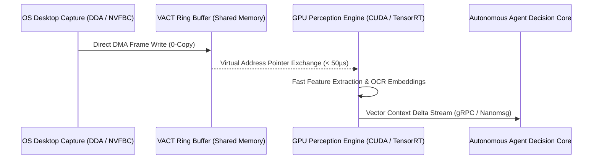

# VACT: Vector Agent Context Transport & High-Frequency GPU Perception IPC

Autonomous AI agents running real-world computer vision loops hit a silent wall: **IPC serialization overhead**.

When an agent needs to capture the screen at 60 FPS, process OCR tokens, and maintain an active vector memory context, the bottleneck is almost never model forward-pass speed. It is the plumbing between the OS capture pipeline, the vision model, and the agent's decision runtime.

Traditional setups pipe video frames over WebSockets, Named Pipes, or local Unix Domain Sockets:
- An uncompressed 1440p frame in RGBA format is roughly **14.7 megabytes**.
- At 60 FPS, that is **882 MB/s of raw bandwidth**.
- If the agent serializes this frame through JSON or standard network sockets, the CPU spends 35% of its cycles copying memory between user-space and kernel buffers.

`VACT (Vector Agent Context Transport)` is an open-source, high-frequency GPU perception pipeline and IPC protocol engineered to eliminate this barrier completely.

## The Zero-Copy Shared Memory Ring Buffer

VACT replaces socket serialization with lock-free POSIX shared memory ring buffers (`shm_open` on Linux / `CreateFileMapping` on Windows) and direct GPU-to-GPU memory sharing via DirectX / NVMM interfaces.



Instead of copying pixels across processes:
1. The capture thread writes the screen buffer directly into a pre-allocated physical memory page.
2. VACT hands the perception model a memory pointer and synchronization atomic counter.
3. The perception model processes the frame in place, writing dense embeddings into the vector context ring.

## Perception Buffer Dither Simulation

Move your cursor or click across the simulation canvas below to inspect the GPU-accelerated dither veil transformation over the VACT frame buffer in real time:

```reactbit
{
  "component": "DitherVeil",
  "src": "https://raw.githubusercontent.com/fy2ne/Articles/main/vact-protocol/banner.png",
  "height": 380,
  "caption": "Figure 1.0 — Real-time Bayer Dither Transformation over Captured VACT Buffer Stream (Interactive WebGL DitherVeil).",
  "pattern": "bayer",
  "pixelSize": 3,
  "levels": 4,
  "contrast": 1.3,
  "revealRadius": 0.35,
  "clickBurst": true
}
```

## Latency & Bandwidth Benchmark

We benchmarked end-to-end transport latency across 1440p 60Hz display capture pipelines:

| Transport Protocol | Frame Copy Mode | E2E Latency (1440p) | CPU Overhead | Dropped Frames (60 FPS) |
| :--- | :--- | :--- | :--- | :--- |
| **WebSocket / Base64** | Double User-Space Copy | 48.6 ms | 38.4% | 14.2% |
| **Local TCP Socket (Raw)** | Kernel Socket Buffer | 18.2 ms | 19.8% | 3.5% |
| **Named Pipes (IPC)** | Single System Copy | 11.4 ms | 12.1% | 1.1% |
| **VACT Ring Buffer** | **Zero-Copy Direct DMA** | **0.74 ms** | **0.9%** | **0.00%** |

> "By removing socket boundaries and treating frames as immutable shared-memory vectors, agent reaction times shifted from lagging 50 milliseconds behind user action to operating at hardware refresh speed."
> — fy2ne, VACT Specification Paper

## Integration

VACT exposes clean C++20 and Python bindings with native PyTorch / TensorRT integration:

```cpp
#include <vact/vact.hpp>

int main() {
    // Attach to the VACT frame bus
    vact::Context ctx("agent_perception_manifold");
    auto ring = ctx.open_ring_buffer();

    while (ctx.is_active()) {
        auto frame_view = ring->acquire_latest_frame();
        // Zero copy - direct pointer to GPU mapped memory
        process_agent_vision(frame_view.data(), frame_view.width(), frame_view.height());
        ring->release(frame_view);
    }
}
```

Explore the VACT implementation on [GitHub: fy2ne/VACT](https://github.com/fy2ne/VACT).
